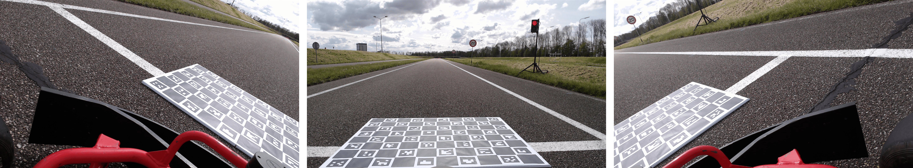
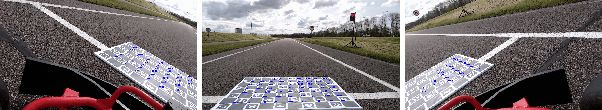
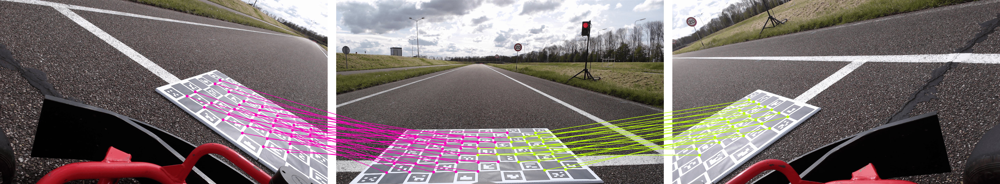
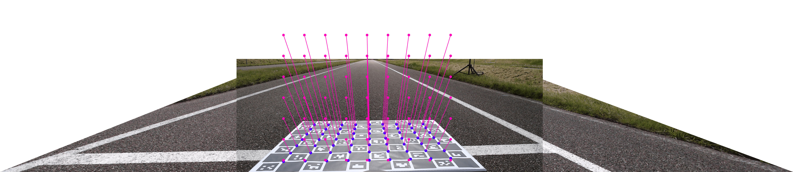
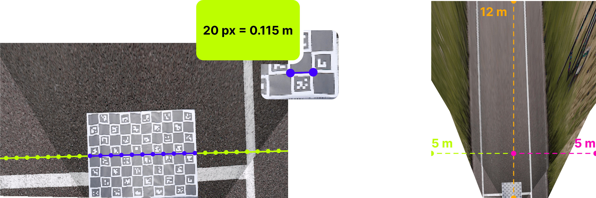
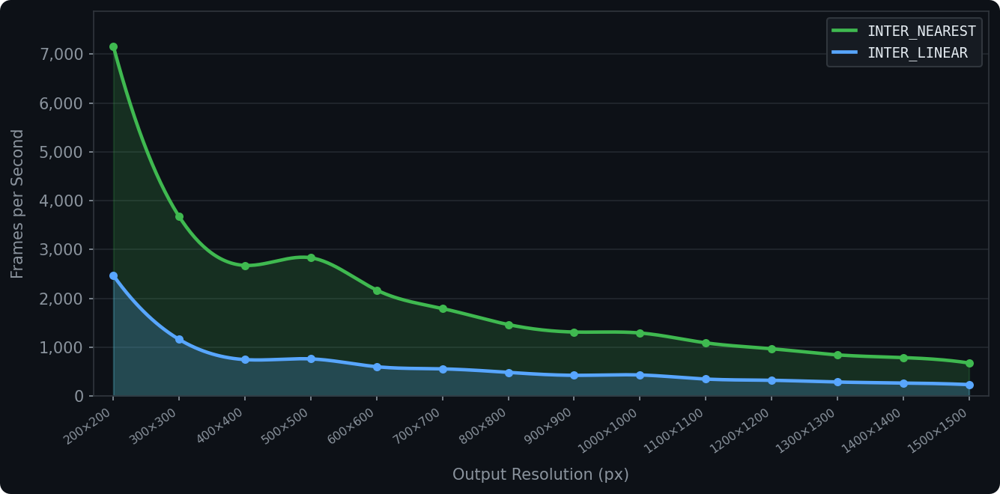

<div align="center">
<h1>ChArUcal</h1>

[![PyPI Version][badge-pypi]][link-pypi]
[![Python Version][badge-python]][link-repo]
[![License][badge-license]](LICENSE)

</div>

`charucal` is a Python library designed to calibrate multi-camera systems and transform their outputs into a single
top-down view. The library utilizes ChArUco boards for precise corner detection and OpenCV for homography estimation.
To ensure the transformation remains efficient enough for real-time applications, `charucal` generates precomputed remap
tables that minimize processing overhead during runtime.

The project was originally developed for the Hanze team’s participation in the [Self Driving Challenge 2024][link-sdc]
to assist with autonomous driving. It is now maintained as a standalone library for anyone who needs a real-time
top-down view from multiple cameras.

## Table of Contents

- [Getting Started](#getting-started)
    - [Installation](#installation)
    - [Basic Usage](#basic-usage)
- [How It Works](#how-it-works)
    - [Step 1. Capture the Images](#step-1-capture-the-images)
    - [Step 2. Detect the Corners](#step-2-detect-the-corners)
    - [Step 3. Calibrate the Cameras](#step-3-calibrate-the-cameras)
        - [Step 3.1. Find the inter-camera homographies](#step-31-find-the-inter-camera-homographies)
        - [Step 3.2. Find the top-down homography](#step-32-find-the-top-down-homography)
    - [Step 4. Transform the Images](#step-4-transform-the-images)
- [Capture Tips](#capture-tips)
- [Performance](#performance)
- [Contributing](#contributing)
- [License](#license)
- [References](#references)

## Getting Started

### Installation

```bash
pip install charucal
```

### Basic Usage

#### 1. Define your board and calibrate

```python
import cv2
from charucal import CalibrationPattern, Calibrator

pattern = CalibrationPattern(
    width=10,
    height=8,
    square_length=0.115,
    marker_length=0.086,
    aruco_dict=cv2.aruco.DICT_4X4_100,
)

calibrator = Calibrator(pattern)

captures = []
for frame_set in your_capture_source:
    capture = calibrator.detect(frame_set)
    if capture.is_complete:
        captures.append(capture)

result = calibrator.calibrate(*captures)
result.save("latest.json")
```

#### 2. Load and transform

```python
import cv2
from charucal import CalibrationResult, CameraTransformer, RenderDistance

calibration = CalibrationResult.load("latest.json")
transformer = CameraTransformer(
    calibration,
    render_distance=RenderDistance(front=10.0, lateral=5.0),
    output_shape=(1000, 1000),
    interpolation=cv2.INTER_LINEAR,
)

topdown = transformer.transform(frames)
```

## How It Works

### Step 1. Capture the Images

To calibrate the cameras, we need to capture images of the ChArUco board from all cameras. It is extremely important
that the ChArUco board is clearly visible in all images. A ChArUco board is a chessboard with ArUco markers on it. The
ArUco markers allow us to tell which corner is which, making it extremely useful for stitching images together.

```python
# Import OpenCV
import cv2

# Initialize the cameras.
cam_left = cv2.VideoCapture(0)
cam_center = cv2.VideoCapture(1)
cam_right = cv2.VideoCapture(2)

# Get the frames of each camera.
ret, frame_left = cam_left.read()
ret, frame_center = cam_center.read()
ret, frame_right = cam_right.read()
```



---

### Step 2. Detect the Corners

Next up is locating the corners of the ChArUco board in all images. OpenCV has a built-in module for dealing with ArUco
markers, called `cv2.aruco`. We can use this module to find the corners of the ChArUco board in each image.



### Step 3. Calibrate the Cameras

The next step is to find the homographies between the cameras. A homography is a transformation matrix that maps points
from one image to another.

#### Step 3.1. Find the inter-camera homographies

For each camera, we find the homography that maps its pixel space to the reference camera's pixel space. The reference
camera is selected automatically as the one with the most shared corners across all other cameras, though it can also be
set manually.



#### Step 3.2. Find the top-down homography

We also find the homography that maps the reference camera's pixel space to real-world metres, using the ChArUco board's
known physical dimensions.



The result is saved to a JSON file so you don't need to recalibrate between sessions.

### Step 4. Transform the Images

The `RenderDistance` you provide determines what part of the world to show. It defines how many metres ahead and to each
side of the camera the output image should cover. Since the ChArUco board can be placed at any angle, the top-down view
would be rotated depending on how it was placed. We correct for this so the output is always properly aligned with the
reference camera.

To figure out what to draw for each pixel in the output, we work backwards. Every pixel in the output represents a
position in the real world, and from the calibration we know exactly how each of those world positions maps back to a
pixel in each source camera. We precompute this mapping for the entire output canvas so that at runtime we can produce
the top-down image as fast as possible.



## Capture Tips

- **Use a large board:** The ChArUco board needs to be large enough for all cameras to see it clearly. If it's too
  small, corner detection and homography estimation will fail or become unstable.
- **Maximize overlap:** The board has to be fully visible in every camera at the same time. Place it right in the middle
  where the camera views overlap.
- **Ensure good lighting:** Reflections and bright spots on the board's surface will cause missed or inaccurate corner
  detections. Try to use matte materials or adjust your lighting to avoid glare.

## Performance

`INTER_NEAREST` is **3.16× faster** on average. Use `INTER_LINEAR` when output quality matters more than throughput.


<sub>Benchmark results for 3 cameras (1080p) on a Ryzen 7 9800X3D (single-threaded)</sub>

## Contributing

Contributions, bug reports, and feature requests are welcome! If you'd like to contribute, please follow these steps:

1. Fork the repository.
2. Create a new branch for your changes.
3. Make your changes and commit them.
4. Push your changes to your fork.
5. Submit a pull request with a description of your changes.

Even if you're not a developer, you can still support the project in other ways. If you find this project useful,
consider showing your appreciation by donating to [my Ko-fi page][link-kofi].

[![ko-fi][badge-kofi]][link-kofi]

## License

This package is licensed under the MIT License. See the [LICENSE](LICENSE) file for more information.

## References

- [Medium: Multi-View Image Stitching based on the pre-calibrated camera homographies](https://senthillihtnes1994.medium.com/multi-view-image-stitching-based-on-the-pre-calibrated-camera-homographies-991e1fe8a6f4)
- [OpenCV: ArUco Marker Detection](https://docs.opencv.org/4.x/d5/dae/tutorial_aruco_detection.html)
- [OpenCV: Camera Calibration and 3D Reconstruction](https://docs.opencv.org/4.x/d9/d0c/group__calib3d.html)
- [OpenCV: Camera Calibration using ChArUco Boards](https://docs.opencv.org/4.x/da/d13/tutorial_aruco_calibration.html)
- [OpenCV: Documentation](https://docs.opencv.org/4.x/)
- [StackOverflow: Bird's eye view perspective transformation from camera calibration opencv python](https://stackoverflow.com/questions/48576087/birds-eye-view-perspective-transformation-from-camera-calibration-opencv-python)
- [Wikipedia: Rotation Matrix](https://en.wikipedia.org/wiki/Rotation_matrix)

<!-- Image References -->

[badge-contribute]:https://img.shields.io/badge/contributions-welcome-orange.svg?style=for-the-badge

[badge-kofi]:https://ko-fi.com/img/githubbutton_sm.svg

[badge-license]:https://img.shields.io/badge/license-MIT-blue.svg?style=for-the-badge

[badge-pypi]:https://img.shields.io/pypi/v/charucal?style=for-the-badge

[badge-python]:https://img.shields.io/pypi/pyversions/charucal?style=for-the-badge

<!-- Links -->

[link-kofi]:https://ko-fi.com/headtrixz

[link-sdc]:https://github.com/HeadTriXz/SDC-2024

[link-pypi]:https://pypi.org/project/charucal

[link-repo]:https://github.com/HeadTriXz/charucal
