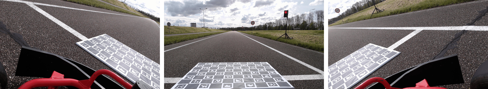
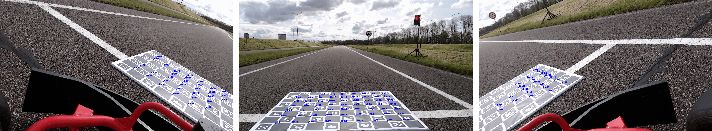
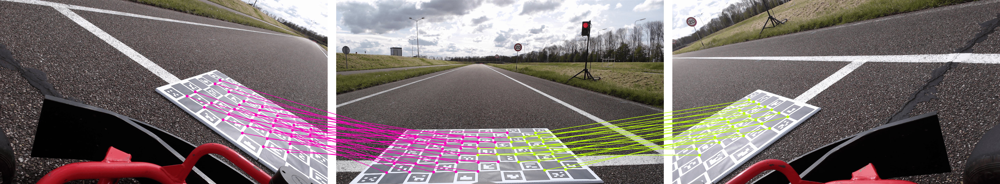
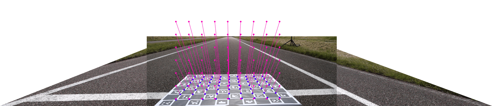
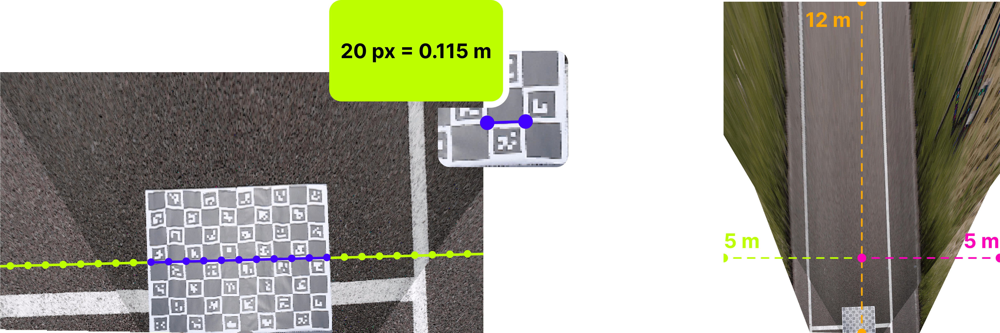

# How It Works

This page explains what `charucal` actually computes during calibration and at runtime. You don't need to understand
any of this to use the library, but it helps when things go wrong.

---

### Step 1. Capture the Images

To calibrate the cameras, we need to capture images of the ChArUco board from all cameras. It is extremely important
that the ChArUco board is clearly visible in all images. A ChArUco board is a chessboard with ArUco markers on it. The
ArUco markers allow us to tell which corner is which, making it extremely useful for stitching images together.



Because corners are identified by ID rather than position, two cameras can share corner matches even if one only sees
the left half of the board and the other only sees the right half.

---

### Step 2. Detect the Corners

Next up is locating the corners of the ChArUco board in all images. OpenCV has a built-in module for dealing with ArUco
markers, called `cv2.aruco`. We can use this module to find the corners of the ChArUco board in each image.



---

### Step 3. Calibrate the Cameras

The next step is to find the homographies between the cameras. A homography is a transformation matrix that maps points
from one image to another.

#### Step 3.1. Find the inter-camera homographies

For each camera, we find the homography that maps its pixel space to the reference camera's pixel space. The reference
camera is selected automatically as the one with the most shared corners across all other cameras, though it can also be
set manually.



Shared corners are corners that both cameras detected in the same capture. The homography is computed with RANSAC so
that a small number of bad detections don't corrupt the result.

#### Step 3.2. Find the top-down homography

We also find the homography that maps the reference camera's pixel space to real-world metres, using the ChArUco
board's known physical dimensions.



The result is saved to a JSON file so you don't need to recalibrate between sessions.

---

### Step 4. Transform the Images

The `RenderDistance` you provide determines what part of the world to show. It defines how many metres ahead and to each
side of the camera the output image should cover. Since the ChArUco board can be placed at any angle, the top-down view
would be rotated depending on how it was placed. We correct for this so the output is always properly aligned with the
reference camera.

To figure out what to draw for each pixel in the output, we work backwards. Every pixel in the output represents a
position in the real world, and from the calibration we know exactly how each of those world positions maps back to a
pixel in each source camera. We precompute this mapping for the entire output canvas so that at runtime we can produce
the top-down image as fast as possible.



This is done by composing the calibration matrices into a single homography per camera:

```
H_combined = H_world_to_pixel × H_topdown × H_stitch[i]
```

Rather than applying this matrix multiplication on every frame, the result is precomputed once into two lookup tables —
`map_x` and `map_y` — one value per output pixel, pointing back to a source column and row. At runtime, `cv2.remap()`
applies these tables directly with no matrix math.
