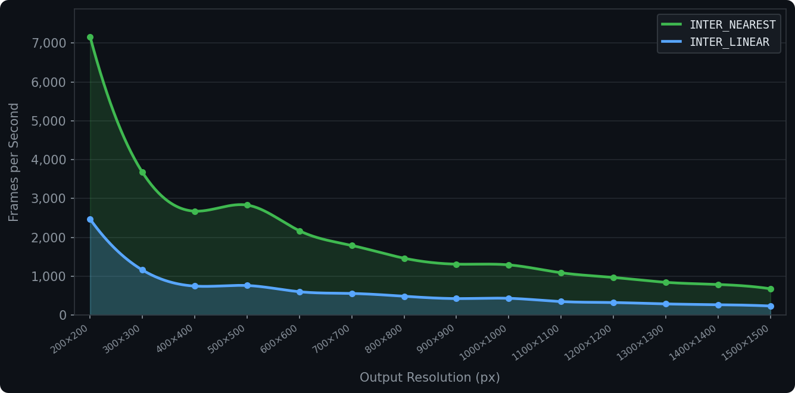

---
hide:
  - navigation
  - toc
---

# ChArUcal

**Real-time top-down view from multiple cameras, powered by ChArUco boards.**

`charucal` is a Python library designed to calibrate multi-camera systems and transform their outputs into a single
top-down view. The library utilizes ChArUco boards for precise corner detection and OpenCV for homography estimation.
To ensure the transformation remains efficient enough for real-time applications, `charucal` generates precomputed remap
tables that minimize processing overhead during runtime.

The project was originally developed for the Hanze team’s participation in the [Self Driving Challenge 2024][link-sdc]
to assist with autonomous driving. It is now maintained as a standalone library for anyone who needs a real-time
top-down view from multiple cameras.

---

<div class="grid cards" markdown>

-   :lucide-settings-2:{ .lg .middle } **Easy to set up**

    ---

    Install with pip, run the `calibrate` CLI tool once, and start transforming frames.

    [:octicons-arrow-right-24: Installation](getting-started/installation.md)

-   :lucide-camera:{ .lg .middle } **Works with any cameras**

    ---

    USB webcams, CSI cameras, video files — anything OpenCV can open.

    [:octicons-arrow-right-24: Quick Start](getting-started/quick-start.md)

-   :lucide-timer:{ .lg .middle } **Built for real-time**

    ---

    At 1000x1000 output, a single thread processes 3 simultaneous 1080p cameras at over 1200 FPS
    with nearest-neighbor interpolation and over 400 FPS with bilinear.

    [:octicons-arrow-right-24: How It Works](how-it-works.md)

-   :lucide-braces:{ .lg .middle } **Python API**

    ---

    A handful of classes cover the full workflow: detection, calibration, and transformation.

    [:octicons-arrow-right-24: API Reference](api/index.md)

</div>

---

## Basic Usage

ChArUcal's workflow is split into two phases: a one-time calibration step, and a per-frame
transformation step that runs at runtime.

**Define your board and calibrate:**

```python
import cv2
from charucal import CalibrationPattern, Calibrator

pattern = CalibrationPattern(
    width=10,
    height=8,
    square_length=0.115,
    marker_length=0.086,
    aruco_dict=cv2.aruco.DICT_4X4_100,
)

calibrator = Calibrator(pattern)

captures = []
for frame_set in your_capture_source:
    capture = calibrator.detect(frame_set)
    if capture.is_complete:
        captures.append(capture)

result = calibrator.calibrate(*captures)
result.save("calibration.json")
```

**Load and transform:**

```python
from charucal import CalibrationResult, CameraTransformer, RenderDistance

calibration = CalibrationResult.load("calibration.json")
transformer = CameraTransformer(
    calibration,
    render_distance=RenderDistance(front=10.0, side=5.0),
    output_shape=(1000, 1000),
)

topdown = transformer.transform(frames)
```

---

## Performance

Remap maps are precomputed once at initialization, so `transform()` does minimal work per frame.
`INTER_NEAREST` is **3.16× faster** on average. Use `INTER_LINEAR` when output quality matters
more than throughput.


<sub>3 cameras (1080p input, 1000×1000 output) · Ryzen 7 9800X3D · single-threaded</sub>

[link-sdc]:https://github.com/HeadTriXz/SDC-2024
